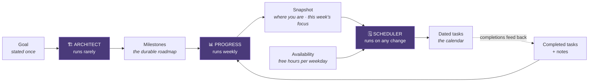
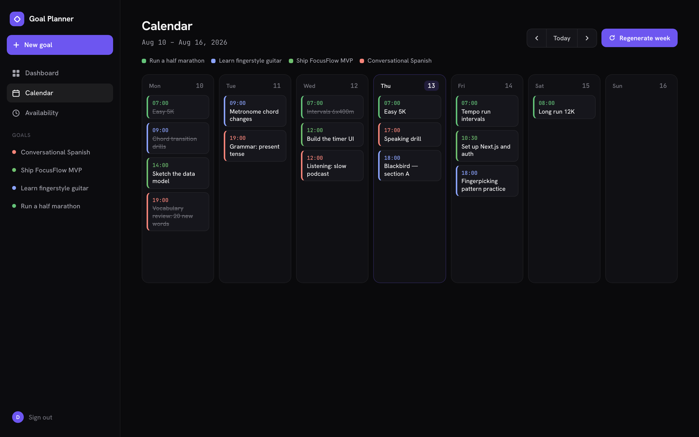

# Goal Planner

Turns a stated goal into a milestone roadmap, then schedules the work into the hours you're actually free.

**[Live demo →](https://goals.example.com)** · one click to explore, no signup

<!-- TODO: replace the URL above with the real deployment once it's live. -->


---

## The problem

Goal-setting apps give you a checklist and planning apps give you a calendar,
but neither closes the gap between them: you still have to work out, every week,
which of your long-term goals deserves your Tuesday evening. That translation is
the actual work, and it has to be redone constantly as real life knocks the plan
off course.

Goal Planner does that translation. It breaks a goal into a roadmap, works out
where you currently are in it, and lays the next concrete step onto a real
calendar — then re-does all of that whenever things change.

---

## How it works



Planning is **three separate agents with one job each**, rather than a single
"plan my goal" prompt:

- **Architect** — goal → a roadmap of 3–6 sequential milestones. Runs rarely.
- **Progress** — reads the roadmap plus the last two weeks of completions and
  notes, and works out where you are and what this week's focus should be. It
  deliberately writes no tasks.
- **Scheduler** — takes the current focus of *every* active goal plus your
  availability, and produces dated tasks. Runs on any change.

### Why three agents instead of one prompt

**They have different natural cadences.** A roadmap should be stable —
regenerating it weekly would mean the goal keeps changing shape underneath you.
The daily calendar should be rewritten freely. One agent would force a single
rate on both.

**Evaluation must not be able to write tasks.** If one agent both judged progress
and wrote the schedule, a bad judgement would silently rewrite your week with no
visible cause. Progress returns an assessment and nothing else; only the
Scheduler writes tasks. A wrong assessment produces a visibly wrong *focus* you
can correct, rather than a silently wrong *week*.

**Cross-goal balancing needs one scheduler.** Fitting four goals into a finite
week is inherently global — the Scheduler sees all active goals at once, which is
why it can avoid stacking three of them onto the same Tuesday evening. Per-goal
planning structurally cannot do that.

### Adaptive regeneration

Creating a goal, requesting an adjustment, and refreshing the week all funnel
through one function, `runScheduler()`. Two properties make it safe to run
repeatedly:

- **Completed work is never destroyed.** The delete is scoped to
  `completed: false`. Regenerating a week you're halfway through rewrites only
  what you haven't done — which is what lets the whole week be rebuilt from
  current state rather than diffed.
- **The rewrite is atomic.** Delete and insert run in a single transaction, so
  either the whole new layout lands or the old one is untouched.

### The model decides *what*, code decides *when*

The Scheduler picks which **day** a task belongs on — a judgement call about
pacing. It does not pick the time of day. That's a deterministic packer that
walks each day's free blocks and assigns start/end times, because "does a
45-minute task fit between 09:00 and 09:30" is exact arithmetic, and an LLM is
both slower and less reliable at it than a `while` loop.

Tasks that don't fit come back unplaced rather than dropped or overlapped, so an
overbooked day is visible instead of silently truncated.



### LLM integration

All model access goes through one function, `generate()` in
`lib/agents/client.ts`. Nothing else imports the Anthropic SDK.

**Structured outputs, not prompt-and-hope.** Each agent declares its output as a
Zod schema, which is compiled to JSON Schema and passed as `output_config.format`
— constraining generation rather than asking for a format in prose. This
replaced an earlier approach that requested "raw JSON only, no markdown" and then
stripped code fences with a regex before `JSON.parse`, which broke on any prose
preamble or nested fence. Because format is now enforced at generation time, the
prompts contain no formatting instructions at all and are shorter and more
focused on the actual task.

**Two layers of validation, because schema conformance isn't correctness.** The
schema proves a task has a `goalId: string`; it cannot prove that goal exists or
belongs to this user. So a semantic layer runs on top: it discards tasks
referencing unknown goals or out-of-range dates, rewrites cross-goal milestone
references, clamps percentages, and strips hallucinated milestone ids. Without
it, a structurally perfect response could still violate a foreign key or set a
goal's progress to 150%.

**Failures degrade instead of throwing.** `generate()` never throws. Every
failure mode — rate limit, timeout, truncated generation, malformed output,
refusal, no API key — resolves to a deterministic fallback plus a typed reason
(`rate_limited`, `invalid_output`, `demo_mode`, …), which is logged and surfaced
in the API response as `source: "llm" | "fallback"`.

Retry policy is split deliberately: transport failures (429/5xx/network) are
retried by the SDK, which already does exponential backoff with jitter and
honours `retry-after`, so reimplementing it badly would be worse. Semantic
failures — output the SDK considers a success but the schema rejects — can only
be handled at the application layer, and get one retry before falling back.

### Demo mode

The public demo runs with `DEMO_MODE=true`, which forces the deterministic path
even if a key is present.

This is a design constraint, not a limitation. Signup is open, so a deployed
instance holding a live API key is effectively an open proxy to a paid API —
any visitor could loop goal creation and spend real money. Demo mode makes that
structurally impossible rather than relying on rate limits.

The whole product still works: every agent has a real planner behind it, so
roadmaps, assessments, scheduling and regeneration all function end to end with
no key and no network. The fallbacks are held to the same schemas as model output
and tested against them, so the demo path can't drift out of contract.

---

## Tech stack

| Layer | Choice |
|---|---|
| Framework | Next.js 14 (App Router), React 18, TypeScript |
| Styling | Tailwind CSS |
| Database | PostgreSQL via Prisma 6 |
| Auth | NextAuth (credentials, JWT sessions), bcrypt |
| LLM | Anthropic API (Claude Opus 4.8) via `@anthropic-ai/sdk`, with Zod-derived structured outputs |
| Testing | Vitest — 60 unit tests, no database or network required |
| CI | GitHub Actions — typecheck, tests, production build |
| Hosting | Vercel + Neon Postgres |

This is LLM *integration* and application engineering — prompt design, structured
output enforcement, validation, and failure handling around a hosted model API.
No model training or fine-tuning is involved.

---

## Running it locally

**Prerequisites:** Node 20+, Docker (for Postgres).

```bash
git clone https://github.com/<you>/goal-planner.git
cd goal-planner
npm install

cp .env.example .env          # defaults work as-is for local development
docker compose up -d          # Postgres on :5434
npx prisma migrate deploy     # apply schema
npx tsx prisma/seed.ts        # seed the demo account

npm run dev
```

Open <http://localhost:3000> and click **Explore the demo**, or sign in with
`demo@example.com` / `demo123`.

No API key is needed — the app runs in demo mode by default and every feature
works. To use real model calls, set `ANTHROPIC_API_KEY` in `.env` and
`DEMO_MODE="false"`.

There's also a `Makefile` wrapping the above: `make setup` then `make dev`.

### Commands

| Command | Does |
|---|---|
| `npm run dev` | Dev server |
| `npm test` | Run the test suite |
| `npm run test:watch` | Tests in watch mode |
| `npm run typecheck` | `tsc --noEmit` |
| `npm run build` | Production build |
| `npm run db:studio` | Browse the database in Prisma Studio |

### Deploying

See **[docs/DEPLOYMENT.md](docs/DEPLOYMENT.md)** for the full Vercel + Neon walkthrough,
including the pooled-vs-direct connection split Prisma needs on serverless and
the subdomain setup.

---

## Documentation

- **[docs/ARCHITECTURE.md](docs/ARCHITECTURE.md)** — system and agent diagrams, the failure-handling
  matrix, data model rationale, and request flows.
- **[docs/DEPLOYMENT.md](docs/DEPLOYMENT.md)** — hosting, environment variables, operational notes.
- **[docs/AI_ENGINEERING_ROADMAP.md](docs/AI_ENGINEERING_ROADMAP.md)** — planned additions (tool use, MCP,
  RAG, caching, evals, agent hosting) and where each plugs into the codebase.

---

## What was interesting, and what I'd change

**The most useful decision was drawing a hard line between what the model decides
and what code decides.** My first version asked the model for a full weekly
schedule including times, and it produced plans that looked right and quietly
didn't add up — tasks overlapping, days overbooked by an hour. Moving time
placement into a deterministic packer fixed it permanently, and the general
lesson stuck: give the model the judgement calls and keep the arithmetic in code.

**Structured outputs removed a whole category of bug rather than reducing it.**
The original parser stripped markdown fences with a regex before `JSON.parse`,
which is fine until the model writes a sentence first. Constraining generation
to a JSON Schema means that failure can't occur — and as a side effect the
prompts got noticeably shorter, because all the "return only valid JSON"
instructions became dead weight.

**The subtlest bug had nothing to do with the LLM.** The time-slot packer groups
tasks by day internally, so its output order doesn't match its input order — but
the caller matched results to inputs positionally. Tasks were being handed each
other's time slots, and only when the scheduler happened to emit days out of
order, which made it look intermittent. It's now keyed by id, and the regression
test pins the exact property that made positional indexing wrong.

**Two things I'd flagged as wrong, and then fixed.** `Task` used to carry both a
`status` string and a `completed` boolean — one fact in two columns, synced by
hand, free to disagree. And goal creation used to make two sequential model calls
inside a single request, which is the slowest path in the app and would exceed a
60-second serverless limit on a slow generation. The first is now a single
`status` column with `completed` derived at the API boundary (the string wins
because it can express "skipped", which matters: regeneration preserves a skipped
task rather than silently rescheduling it). The second is now two requests of one
model call each, with scheduling treated as best-effort so a failure there costs
you the week's layout rather than the whole goal.

**What I'd still do differently:**

- **There's no eval harness for prompt quality.** I can prove the output is
  *well-formed* — that's what the schemas and tests do — but not that a roadmap
  is *good*. A small graded set of goals with rubric-scored outputs is the
  obvious next step, and is what I'd build before changing any prompt again.
- **The dashboard streak calculation loads every task the user has ever had** to
  compute a trailing-weeks figure. Fine at demo scale, wrong in principle; it
  should be a windowed query or a maintained counter.
