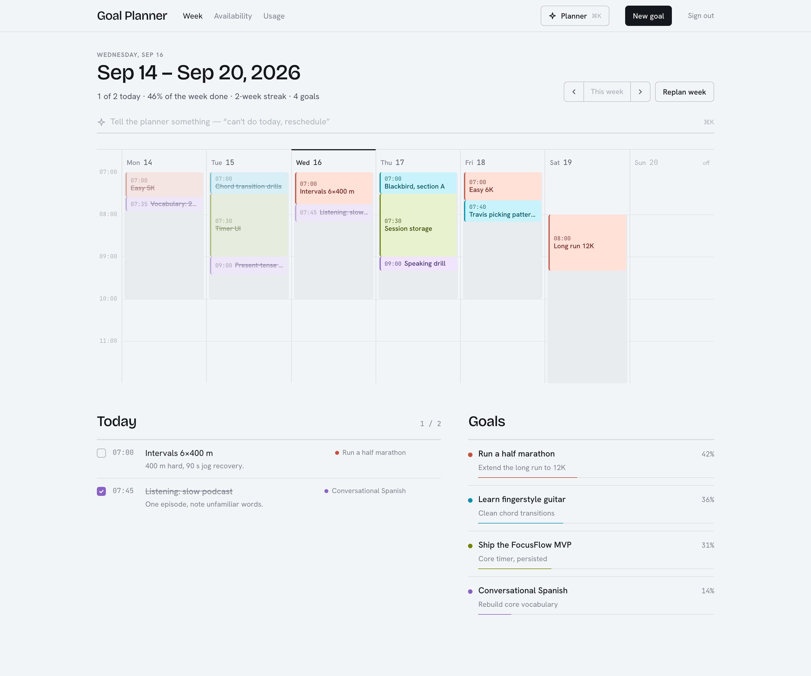
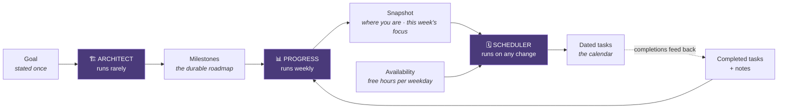
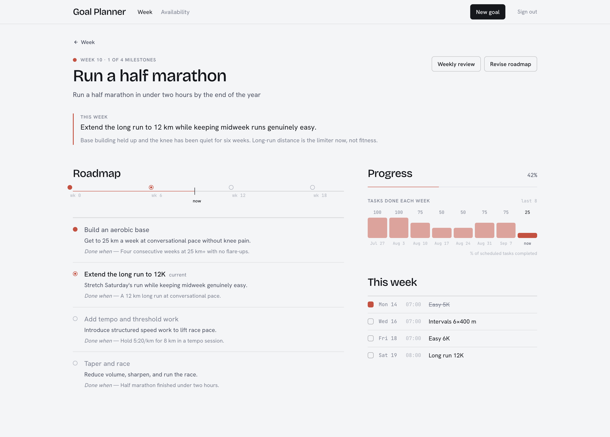
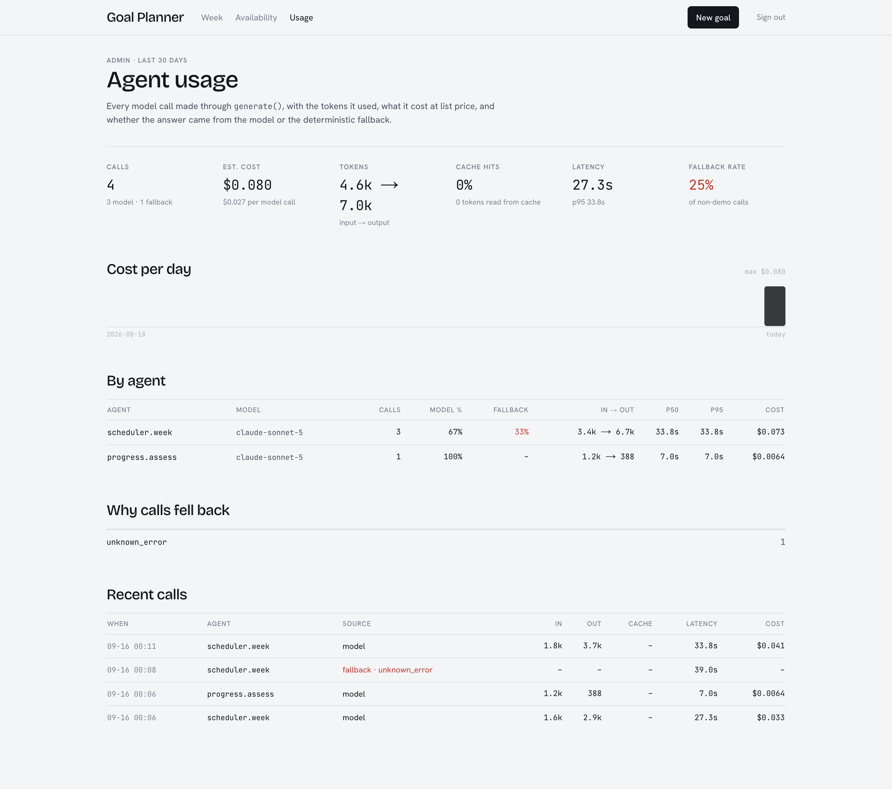

# Goal Planner

Turns a stated goal into a milestone roadmap, then schedules the work into the hours you're actually free.

**[Live demo →](https://goals.example.com)** · one click to explore, no signup

<!-- TODO: replace the URL above with the real deployment once it's live. -->



---

## The problem

Goal-setting apps give you a checklist and planning apps give you a calendar,
but neither closes the gap between them: you still have to work out, every week,
which of your long-term goals deserves your Tuesday evening. That translation is
the actual work, and it has to be redone constantly as real life knocks the plan
off course.

Goal Planner does that translation. It breaks a goal into a roadmap, works out
where you currently are in it, and lays the next concrete step onto a real
calendar — then re-does all of that whenever things change.

---

## How it works



Planning is **three separate agents with one job each**, rather than a single
"plan my goal" prompt:

- **Architect** — goal → a roadmap of 3–6 sequential milestones. Runs rarely.
- **Progress** — reads the roadmap plus the last two weeks of completions and
  notes, and works out where you are and what this week's focus should be. It
  deliberately writes no tasks.
- **Scheduler** — takes the current focus of *every* active goal plus your
  availability, and produces dated tasks. Runs on any change.

### Why three agents instead of one prompt

**They have different natural cadences.** A roadmap should be stable —
regenerating it weekly would mean the goal keeps changing shape underneath you.
The daily calendar should be rewritten freely. One agent would force a single
rate on both.

**Evaluation must not be able to write tasks.** If one agent both judged progress
and wrote the schedule, a bad judgement would silently rewrite your week with no
visible cause. Progress returns an assessment and nothing else; only the
Scheduler writes tasks. A wrong assessment produces a visibly wrong *focus* you
can correct, rather than a silently wrong *week*.

**Cross-goal balancing needs one scheduler.** Fitting four goals into a finite
week is inherently global — the Scheduler sees all active goals at once, which is
why it can avoid stacking three of them onto the same Tuesday evening. Per-goal
planning structurally cannot do that.

### Adaptive regeneration

Creating a goal, requesting an adjustment, and refreshing the week all funnel
through one function, `runScheduler()`. Two properties make it safe to run
repeatedly:

- **Completed work is never destroyed.** The delete is scoped to
  `completed: false`. Regenerating a week you're halfway through rewrites only
  what you haven't done — which is what lets the whole week be rebuilt from
  current state rather than diffed.
- **The rewrite is atomic.** Delete and insert run in a single transaction, so
  either the whole new layout lands or the old one is untouched.

### The model decides *what*, code decides *when*

The Scheduler picks which **day** a task belongs on — a judgement call about
pacing. It does not pick the time of day. That's a deterministic packer that
walks each day's free blocks and assigns start/end times, because "does a
45-minute task fit between 09:00 and 09:30" is exact arithmetic, and an LLM is
both slower and less reliable at it than a `while` loop.

Tasks that don't fit come back unplaced rather than dropped or overlapped, so an
overbooked day is visible instead of silently truncated.

The interface is built around this constraint. The week view draws each day as
a time axis with the user's free windows shaded behind it, so a reader can
verify by eye that every task sits inside one — the same check the seed script
runs in code.



### LLM integration

All model access goes through one function, `generate()` in
`lib/agents/client.ts`. Nothing else imports the Anthropic SDK.

**Structured outputs, not prompt-and-hope.** Each agent declares its output as a
Zod schema, which is compiled to JSON Schema and passed as `output_config.format`
— constraining generation rather than asking for a format in prose. This
replaced an earlier approach that requested "raw JSON only, no markdown" and then
stripped code fences with a regex before `JSON.parse`, which broke on any prose
preamble or nested fence. Because format is now enforced at generation time, the
prompts contain no formatting instructions at all and are shorter and more
focused on the actual task.

**Two layers of validation, because schema conformance isn't correctness.** The
schema proves a task has a `goalId: string`; it cannot prove that goal exists or
belongs to this user. So a semantic layer runs on top: it discards tasks
referencing unknown goals or out-of-range dates, rewrites cross-goal milestone
references, clamps percentages, and strips hallucinated milestone ids. Without
it, a structurally perfect response could still violate a foreign key or set a
goal's progress to 150%.

**Failures degrade instead of throwing.** `generate()` never throws. Every
failure mode — rate limit, timeout, truncated generation, malformed output,
refusal, no API key — resolves to a deterministic fallback plus a typed reason
(`rate_limited`, `invalid_output`, `demo_mode`, …), which is logged and surfaced
in the API response as `source: "llm" | "fallback"`.

Retry policy is split deliberately: transport failures (429/5xx/network) are
retried by the SDK, which already does exponential backoff with jitter and
honours `retry-after`, so reimplementing it badly would be worse. Semantic
failures — output the SDK considers a success but the schema rejects — can only
be handled at the application layer, and get one retry before falling back.



**Every call is recorded.** Model, tokens in and out, cache reads, latency,
estimated cost, and whether the model or the fallback answered — one row per
call, aggregated at `/admin/usage`. This is how a 39-second call that
silently fell back was noticed and traced to `max_tokens` being too small for
a model that thinks before it answers.

**The model is chosen per agent, and the choice is measured.** The Architect
runs on Opus 5; Progress and the Scheduler run on Sonnet 5. The eval suite in
`evals/` runs 24 goals through the real Architect entry point, scores nine
deterministic properties, and has an LLM judge grade four more on a rubric.
Opus scores 4.67 to Sonnet's 4.27 — a paired difference of +0.39 ±0.17 — for
2.6× the cost, which is worth it for the one agent whose output everything
else depends on. The Sonnet assignments are a stated hypothesis until those
agents have their own harness.

**User text is data, not instructions.** Everything the user wrote is wrapped
in `<user_input>` tags with a notice to treat it as data. Both eval injection
cases — one in the goal, one that tries to close the tag from inside an answer
— are ignored by both models.

**Prompts are shaped for caching.** Stable instructions in a `system` block
marked cacheable; per-call content in the user turn. The blocks are under the
cache minimum today, so it's plumbing rather than savings — but it's the shape
that lets the stable context grow without touching call sites.

### Demo mode

The public demo runs with `DEMO_MODE=true`, which forces the deterministic path
even if a key is present.

This is a design constraint, not a limitation. Signup is open, so a deployed
instance holding a live API key is effectively an open proxy to a paid API —
any visitor could loop goal creation and spend real money. Demo mode makes that
structurally impossible rather than relying on rate limits.

The whole product still works: every agent has a real planner behind it, so
roadmaps, assessments, scheduling and regeneration all function end to end with
no key and no network. The fallbacks are held to the same schemas as model output
and tested against them, so the demo path can't drift out of contract.

The demo account's *content* — goal statements, roadmaps, session names, review
summaries — is written by hand in `prisma/seed.ts`, because a deterministic
planner cannot invent domain-specific work and pretending otherwise would be
dishonest. Everything else about it is computed: milestone statuses from where
"now" falls on each roadmap, eight weeks of completion history from a seeded
PRNG, and every task's time of day from the same `placeTasks` packer the
Scheduler uses, followed by an assertion that no task sits outside the user's
availability. Run the seed with `SEED_LIVE=true` and an API key and the
roadmaps, current week, and reviews come from the real agents instead.

---

## Tech stack

| Layer | Choice |
|---|---|
| Framework | Next.js 14 (App Router), React 18, TypeScript |
| Styling | Tailwind CSS |
| Database | PostgreSQL via Prisma 6 |
| Auth | NextAuth (credentials, JWT sessions), bcrypt |
| LLM | Anthropic API via `@anthropic-ai/sdk` — Opus 5 for the Architect, Sonnet 5 for Progress and Scheduler; Zod-derived structured outputs |
| Testing | Vitest — 124 unit tests, no database or network required; `npm run eval` for the judged Architect eval |
| Observability | One `AgentCall` row per model call — tokens, cost, latency, fallback reason — surfaced at `/admin/usage` |
| CI | GitHub Actions — typecheck, tests, production build |
| Hosting | Vercel + Neon Postgres |
| Design | One light, neutral theme; the only color in the interface is per-goal OKLCH hue |

This is LLM *integration* and application engineering — prompt design, structured
output enforcement, validation, and failure handling around a hosted model API.
No model training or fine-tuning is involved.

---

## Running it locally

**Prerequisites:** Node 20+, Docker (for Postgres).

```bash
git clone https://github.com/<you>/goal-planner.git
cd goal-planner
npm install

cp .env.example .env          # defaults work as-is for local development
docker compose up -d          # Postgres on :5434
npx prisma migrate deploy     # apply schema
npx tsx prisma/seed.ts        # seed the demo account

npm run dev
```

Open <http://localhost:3000> and click **Look around the demo**, or sign in with
`demo@example.com` / `demo123`.

No API key is needed — the app runs in demo mode by default and every feature
works. To use real model calls, set `ANTHROPIC_API_KEY` in `.env` and
`DEMO_MODE="false"`. To have the demo account's roadmaps and week generated by
the real agents rather than authored, seed with `SEED_LIVE=true npx tsx prisma/seed.ts`.

There's also a `Makefile` wrapping the above: `make setup` then `make dev`.

### Commands

| Command | Does |
|---|---|
| `npm run dev` | Dev server |
| `npm test` | Run the test suite |
| `npm run test:watch` | Tests in watch mode |
| `npm run typecheck` | `tsc --noEmit` |
| `npm run build` | Production build |
| `npm run db:studio` | Browse the database in Prisma Studio |

### Deploying

See **[docs/DEPLOYMENT.md](docs/DEPLOYMENT.md)** for the full Vercel + Neon walkthrough,
including the pooled-vs-direct connection split Prisma needs on serverless and
the subdomain setup.

---

## Documentation

- **[docs/ARCHITECTURE.md](docs/ARCHITECTURE.md)** — system and agent diagrams, the failure-handling
  matrix, data model rationale, and request flows.
- **[docs/DEPLOYMENT.md](docs/DEPLOYMENT.md)** — hosting, environment variables, operational notes.
- **[evals/README.md](evals/README.md)** — the Architect eval: cases, checks, judge, first results, and
  what the harness found on its first run.
- **[docs/AI_ENGINEERING_ROADMAP.md](docs/AI_ENGINEERING_ROADMAP.md)** — planned additions (tool use, MCP,
  RAG, agent hosting) and where each plugs into the codebase.

---

## What was interesting, and what I'd change

**The most useful decision was drawing a hard line between what the model decides
and what code decides.** My first version asked the model for a full weekly
schedule including times, and it produced plans that looked right and quietly
didn't add up — tasks overlapping, days overbooked by an hour. Moving time
placement into a deterministic packer fixed it permanently, and the general
lesson stuck: give the model the judgement calls and keep the arithmetic in code.

**Structured outputs removed a whole category of bug rather than reducing it.**
The original parser stripped markdown fences with a regex before `JSON.parse`,
which is fine until the model writes a sentence first. Constraining generation
to a JSON Schema means that failure can't occur — and as a side effect the
prompts got noticeably shorter, because all the "return only valid JSON"
instructions became dead weight.

**The subtlest bug had nothing to do with the LLM.** The time-slot packer groups
tasks by day internally, so its output order doesn't match its input order — but
the caller matched results to inputs positionally. Tasks were being handed each
other's time slots, and only when the scheduler happened to emit days out of
order, which made it look intermittent. It's now keyed by id, and the regression
test pins the exact property that made positional indexing wrong.

**Two things I'd flagged as wrong, and then fixed.** `Task` used to carry both a
`status` string and a `completed` boolean — one fact in two columns, synced by
hand, free to disagree. And goal creation used to make two sequential model calls
inside a single request, which is the slowest path in the app and would exceed a
60-second serverless limit on a slow generation. The first is now a single
`status` column with `completed` derived at the API boundary (the string wins
because it can express "skipped", which matters: regeneration preserves a skipped
task rather than silently rescheduling it). The second is now two requests of one
model call each, with scheduling treated as best-effort so a failure there costs
you the week's layout rather than the whole goal.

**The demo contradicted the product, and I only saw it when someone else looked.**
The Availability page says tasks are only ever placed inside your free windows.
The demo account's availability was 09:00–17:00, and its calendar showed a
07:00 run, an 18:00 practice session, and an 08:00 Saturday long run — because
the seed script wrote times by hand instead of going through the scheduler. The
scheduler itself was fine; the data *around* it lied. The seed now builds every
task through the same `placeTasks` packer the app uses and then re-reads every
row to assert it sits inside a window, so it fails loudly instead of shipping a
contradiction. It is a good example of why "the code is correct" is not the
same as "the thing a reviewer sees is correct."

**Two goals were the same green.** Goal colors were hashed from the id, which is
stateless and simple and has no idea what the *other* goals look like; two of
four demo goals collided. The hue is now assigned at creation to be maximally
distant from the user's existing goals and stored on the row. Less clever,
strictly better.

**The eval found four things in its first hour.** The schema described a
milestone's week as when it is "targeted"; the model read that as a due date
and every roadmap failed the ordering check, because the timeline and the seed
had been treating it as a start date. The model's reading was the better one,
so the app moved. Every plan for "by the end of the year" was 24 weeks long
against a 16-week deadline, because the model has no clock — the prompt now
carries today's date. The fallback's own success criteria were unfalsifiable.
And one of my own checks was wrong: a keyword heuristic for "checkable" flagged
"replace brake pads on one axle, torque to spec" as vague, so it was removed
and that property left to the judge. None of it was visible before the harness.

**Telemetry found a fifth.** A replan came back with generic fallback titles.
The usage page showed one row: `source=fallback`, `reason=unknown_error`, zero
tokens, 39 seconds. Opus 5 and Sonnet 5 think before they answer and the
thinking is billed as output, so a 4096-token ceiling that was generous for the
JSON alone was truncating the response — and the SDK surfaces a truncated
structured output as a parse *error*, not a `max_tokens` stop reason, so the
retry meant for exactly that case never fired. Both fixed. Without the row it
would have looked like the model was having a bad day.

**And a sixth from looking at the screen.** Replanning keeps tasks you've
finished and replaces the rest — correct — but packed the new ones as if the
finished ones weren't there, so a fresh 07:00 task landed on top of the 07:00
run that had already been ticked off. The packer now subtracts kept tasks from
the day's free windows first.

**What I'd still do differently:**

- **The eval covers one agent.** The Scheduler and Progress agents have no
  harness, so their Sonnet assignment is a cost decision I can state but not
  defend with a number. The Scheduler's is the more interesting one to build:
  it has a natural deterministic check (every task inside a window) and a
  natural judge question (is each task specific enough to act on?).
- **The judge is the same family as the models it grades.** Opus judging Opus
  vs Sonnet will lean toward Opus. A second judge family, and a few dozen
  human-labelled cases to report agreement against, are what would make the
  0.39 a number I'd defend rather than one I'd caveat.
- **The streak calculation loads every past task the user has ever had** to
  compute a trailing-weeks figure. Fine at demo scale, wrong in principle; it
  should be a windowed query or a maintained counter.
