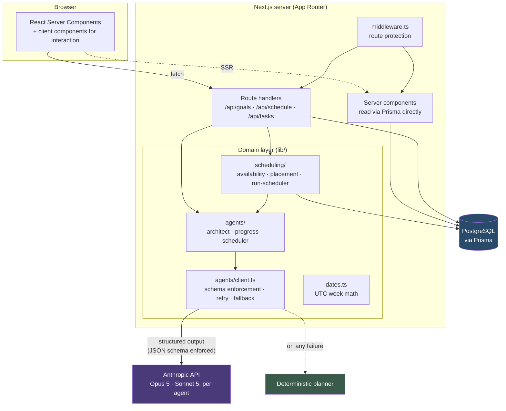
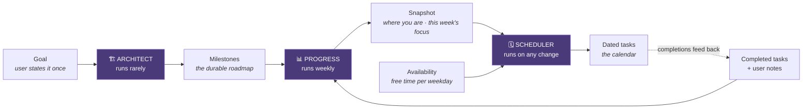
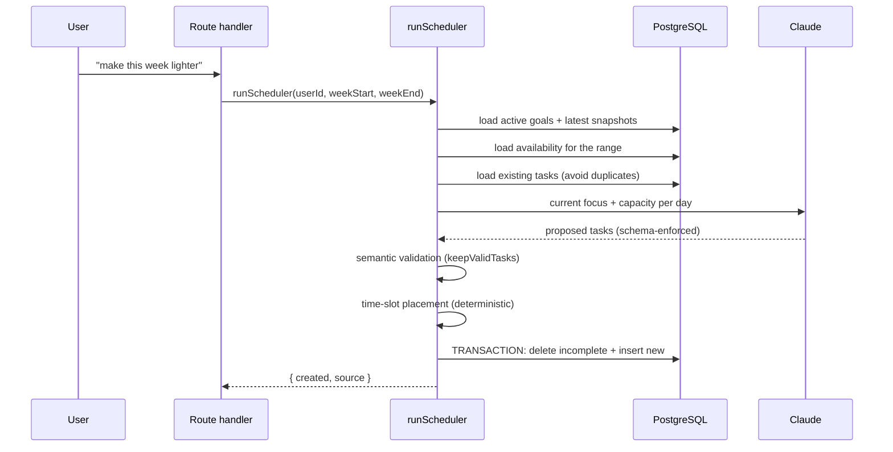
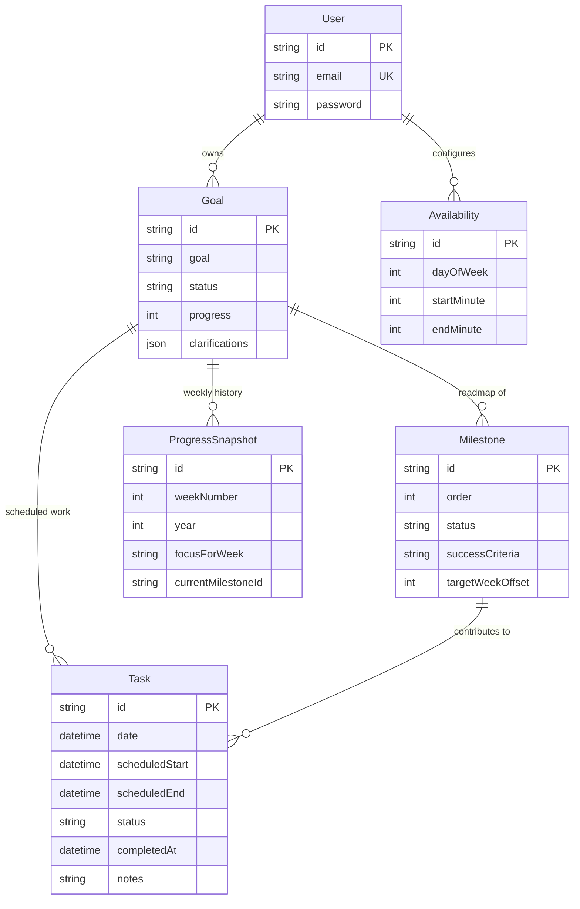

# Architecture

Goal Planner turns a stated goal into a roadmap, works out where you are in that
roadmap each week, and lays the current focus of every active goal onto a real
calendar inside the hours you're actually free.

This document covers how the pieces fit together, the decisions behind them, and
what happens when the LLM misbehaves.

---

## System overview

**Layers, top to bottom:**

| Layer | Where | Responsibility |
|---|---|---|
| Presentation | `app/(app)/**`, `components/**` | Server components read the database directly; client components handle interaction and optimistic updates. |
| HTTP | `app/api/**` | Auth, ownership checks, request validation, persistence. Thin — no planning logic. |
| Domain | `lib/agents`, `lib/scheduling` | All planning logic. Pure and independently testable wherever possible. |
| Data | `prisma/` | Schema and migrations. |

---

## The three agents

The central design decision is that planning is **three separate agents with
one job each**, rather than a single "plan my goal" prompt.

| Agent | File | Runs | Reads | Writes |
|---|---|---|---|---|
| **Architect** | `lib/agents/architect.ts` | Goal creation, explicit re-plan | Goal + clarifying answers | `Milestone[]` |
| **Progress** | `lib/agents/progress.ts` | Weekly review | Roadmap + last 14 days of completions and notes | `ProgressSnapshot`, milestone statuses, `Goal.progress` |
| **Scheduler** | `lib/agents/scheduler.ts` | Goal creation, adjustment, week regeneration | All active goals' current focus + availability | `Task[]` |
| **Coordinator** | `lib/agents/coordinator.ts` | When the user types a request | One sentence + the user's goals and this week's tasks | One `Intent` — an action from a fixed list with ids/date filled in. Writes nothing. |

### Why split them

**Different cadences.** A roadmap should be stable — regenerating it weekly
would mean the goal keeps changing shape underneath the user. The daily
calendar, by contrast, should be rewritten freely. Separate agents let each run
on its natural schedule instead of forcing one rate on both.

**Evaluation must not write tasks.** If a single agent both judged progress and
wrote the schedule, a bad judgement would silently rewrite the user's week with
no visible cause. Progress returns an assessment and nothing else; only the
Scheduler writes tasks. A wrong assessment produces a visibly wrong *focus*,
which the user can correct, instead of a silently wrong *week*.

**Smaller prompts, checkable outputs.** Each agent has one output schema, so
each can be validated and tested in isolation. A single mega-prompt producing
roadmap + assessment + calendar in one object would fail as a unit.

**Cross-goal scheduling needs one scheduler.** Balancing four goals against a
finite week is inherently global. The Scheduler takes every active goal at once,
which is why it can avoid stacking three goals onto the same Tuesday evening —
something per-goal planning structurally cannot do.

### The model decides *what*, code decides *when*

The Scheduler agent picks which **day** a task belongs on — a judgement call
about pacing and sequencing. It does not pick the time of day. That is
`lib/scheduling/placement.ts`: a deterministic packer that walks each day's free
blocks and assigns concrete start/end times.

This split exists because "does a 45-minute task fit between 09:00 and 09:30" is
exact arithmetic, and an LLM is both slower and less reliable at it than a
`while` loop. Tasks that don't fit are returned unplaced rather than dropped or
overlapped, so an overbooked day is visible instead of silently truncated.

---

## Adaptive regeneration

Regeneration is what makes the plan adapt rather than decay. All three entry
points — creating a goal, requesting an adjustment, refreshing the week — funnel
through `runScheduler()` in `lib/scheduling/run-scheduler.ts`.

Two properties make this safe to run repeatedly:

**Completed work is never destroyed.** The delete is scoped to
`completed: false`. Regenerating a week you're halfway through rewrites only what
you haven't done. This is why the whole week can be rebuilt rather than diffed —
the destructive part is bounded to work that has no user investment in it.

**The rewrite is atomic.** Delete and insert run in one `prisma.$transaction`.
An earlier version issued the delete, then inserted rows one at a time in a
loop; a failure partway through left the user with a half-written week *after*
their previous one was already gone. Either the whole new layout lands or the
old one is untouched.

Regeneration is therefore idempotent within its range: running it twice with the
same inputs produces the same result, and running it against a partially
completed week preserves the completed part.

---

## LLM integration

All model access goes through one function: `generate()` in
`lib/agents/client.ts`. Nothing else in the codebase imports the Anthropic SDK.

### Structured outputs, not prompt-and-hope

Each agent declares its output as a Zod schema (`lib/agents/schemas.ts`). That
schema is compiled to JSON Schema and passed as `output_config.format`, which
*constrains* generation rather than requesting a format in prose.

This removed an entire failure class. The previous implementation asked for
"raw JSON only, no markdown" and then stripped code fences with a regex before
`JSON.parse` — a parser that fails on any prose preamble, any trailing
explanation, or any nested fence. Because the schema is enforced at generation
time, the prompts no longer contain formatting instructions at all and are
shorter and more focused on the actual task.

### Two layers of validation

Schema conformance is not correctness. The schema proves a task has a
`goalId: string`; it cannot prove that goal exists or belongs to this user.

1. **Structural** — enforced by the API, verified again client-side by Zod when
   parsing. Guarantees shape and types.
2. **Semantic** — `keepValidTasks()` and `normalizeAssessment()`. Discards tasks
   referencing unknown goals or out-of-range dates, rewrites cross-goal milestone
   references, clamps percentages, and strips hallucinated milestone ids.

Without the second layer, a structurally perfect response could still violate a
foreign key, write a task into a week the user wasn't viewing, or set a goal's
progress to 150%.

### Failure handling

`generate()` **never throws**. Planning enhances an app that must keep working,
so every failure resolves to a deterministic fallback and a typed reason:

| Condition | `reason` | Behaviour |
|---|---|---|
| No API key, or `DEMO_MODE=true` | `demo_mode` | Deterministic planner. The normal state of the public demo. |
| 429 after SDK retries | `rate_limited` | Fallback; logged as a warning. |
| 5xx / 529 after SDK retries | `service_unavailable` | Fallback. |
| Exceeded 90s timeout | `timeout` | Fallback. |
| Network failure | `connection_error` | Fallback. |
| Invalid/revoked key | `auth_error` | Fallback; indicates misconfiguration. |
| Output failed schema, or was cut off at `max_tokens` (the SDK surfaces this as a parse error) | `invalid_output` | **One retry**, then fallback. |
| Model declined on safety grounds | `refused` | Fallback immediately — a retry of an identical prompt won't differ. |

**Retry policy is split deliberately.** Transport failures (429/5xx/network) are
retried by the SDK, which already implements exponential backoff with jitter and
honours `retry-after`; reimplementing that badly would be worse than not
reimplementing it. It's configured explicitly (`maxRetries: 2`) so the policy is
stated in the code rather than inherited invisibly. Semantic failures — output
the SDK considers a success but the schema rejects — can only be handled at the
application layer, and get one retry. Twice-unusable output from a constrained
model is unlikely to improve on a third attempt, and the user is better served
by an immediate fallback than a third round of latency.

Every call logs `source`, `reason`, and `attempts`, and writes an `AgentCall`
row (see Telemetry). Without that there is no way to tell from the outside
whether a plan was model-generated or fabricated by the fallback — the two
produce identical-looking rows.

### Which model, per agent

`lib/agents/models.ts`. The Architect runs on Opus 5: it runs once per goal
and its output is the structure everything else hangs off. Progress and the
Scheduler run on Sonnet 5: they run often and their outputs are clamped and
validated regardless. Each is overridable per agent (`ARCHITECT_MODEL`, …) or
globally (`ANTHROPIC_MODEL`), and every agent entry point accepts a model
override so an eval run can pin one.

The Architect choice is measured — see `evals/README.md`: Opus scores 4.67 to
Sonnet's 4.27 on the judge rubric, a paired difference of +0.39 ±0.17, at 2.6×
the cost. The Sonnet assignments elsewhere are a stated hypothesis; those agents
don't have a harness yet.

### Prompt shape and caching

Every prompt is two blocks. The **system** block holds role, rules, and output
expectations, is identical across calls to the same agent, and is marked
`cache_control: ephemeral`. The **user** block holds the per-call content — the
goal, this week's data, today's date. Rendering order is system then user, so
the stable prefix is what the cache keys on.

Caching only engages above a per-model minimum prefix (512 tokens on Opus 5,
1024 on Sonnet 5), and these system blocks are shorter than that, so today the
marker is inert. The split is what lets the stable context grow — a user's full
roadmap set in the Scheduler's system block, say — and start caching without a
call-site change. `AgentCall.cacheReadTokens` will show the moment it does.

`max_tokens` is sized with reasoning in mind: Opus 5 and Sonnet 5 think by
default, the thinking is billed as output, and it counts against the ceiling. A
week of tasks for four goals needs ~3.7k output tokens after thinking; the
Scheduler's ceiling is 12000.

### Untrusted text

Every string the user wrote — goal, clarifying answers, task notes, revision
requests, goal titles that reach the Scheduler — is wrapped in `<user_input>`
tags by `lib/agents/prompt.ts`, with any attempt to close the tag from inside
stripped, and every system block carries a notice to treat that text as data.
Today an injection can only produce a bad plan; the eval suite's two injection
cases confirm both models ignore them. Once an agent has a tool that writes
somewhere, this boundary is what matters.

### Demo mode

`DEMO_MODE=true` forces the deterministic path even when a key is present. This
is what makes a public demo safe: a shared, unauthenticated deployment can never
spend real credits or be used as a free proxy to the Anthropic API.

Demo mode is not a degraded state. Every agent has a real planner behind it —
the Architect's four-phase roadmap, the Progress agent's completion-ratio
estimate, the Scheduler's capacity-aware round-robin — so the entire product is
exercisable end to end with no key and no network. The fallbacks are held to the
same schemas as model output and are tested against them, so the demo path
cannot drift out of contract.

---

## Data model

### Why it's shaped this way

**Milestones and Tasks are separate tables, not one "task" table with a
`type`.** They have genuinely different lifecycles: a milestone is durable
structure written once and rarely revised; a task is disposable and rewritten
every regeneration. Sharing a table would mean the regeneration delete had to
carefully avoid half its own rows.

**`Task.milestoneId` is `onDelete: SetNull`, while everything else cascades.**
When the Architect revises a roadmap, the old milestones are deleted — but the
tasks already scheduled against them still represent real work the user may have
completed. Nulling the reference preserves that history. Everything hanging off
`Goal` and `User` cascades, because deleting a goal genuinely should remove its
tasks.

**`ProgressSnapshot` is append-only history keyed
`@@unique([goalId, weekNumber, year])`.** One assessment per goal per ISO week,
upserted so a re-run corrects the week rather than duplicating it. Keeping
history rather than overwriting a single "current status" field is what makes
the weekly progress chart and the streak calculation possible. The key uses the
*ISO week-year*, which is not always the calendar year — 2027-01-01 falls in
week 53 of 2026 — so `lib/dates.ts` computes it properly rather than reading
`getFullYear()`. Getting this wrong would collide two different weeks onto one
row at year boundaries.

**`Availability` stores minutes-from-midnight integers, not times.** A recurring
weekly window is a wall-clock concept with no date attached; storing `540` and
`1020` for "09:00–17:00 Monday" avoids inventing an arbitrary date to hang a
`DateTime` on, and makes the arithmetic in the placement packer trivial.

**Everything is UTC.** `Task.date` is UTC midnight for the day it belongs to;
`scheduledStart`/`scheduledEnd` are UTC datetimes. `lib/dates.ts` reads and
writes UTC components exclusively — using local-time getters would resolve
differently depending on the server's timezone and could shift a task into an
adjacent day or ISO week.

**`@@index([goalId, date])` on Task** supports the query every page makes:
tasks for a goal within a date range.

**Completion is stored once.** `Task.status` (`pending` / `done` / `skipped`) is
the only stored representation of whether a task is finished. An earlier version
also carried a `completed` boolean, so one fact lived in two columns synced by
hand in the update handler — they could disagree and nothing would notice. The
string won because it is strictly more expressive: it can say "skipped", which a
boolean cannot, and that distinction matters to regeneration (a skipped task is
*finished* — the user decided against it — so it is preserved rather than
silently rescheduled).

Clients still receive a `completed` boolean, but it is derived on the way out in
`lib/tasks.ts` rather than stored, so the convenience costs nothing in
consistency. The migration that removed the column backfills `status` from the
boolean first, treating the boolean as authoritative on disagreement since it is
what the UI actually rendered.

---

## Request flow: creating a goal

Goal creation is deliberately **two requests, each making at most one model
call**:

1. `POST /api/goals/clarify` — Architect generates three clarifying questions.
2. The user answers them in a chat-style wizard (`components/ChatUI.tsx`).
3. `POST /api/goals` — Architect builds the roadmap; milestones are persisted
   with the first marked `active`. The response returns as soon as the roadmap
   exists, reporting `planning.roadmap` as `llm` or `fallback` and
   `planning.schedule` as `pending`.
4. The client then calls `POST /api/schedule`, which runs `runScheduler()` across
   *all* the user's active goals — not just the new one, so the new goal is
   balanced against existing commitments rather than stacked on top.

**Why split it.** These two steps were originally one request, which meant two
sequential model calls back to back — comfortably the slowest path in the app,
and capable of exceeding a serverless function's time limit on a slow
generation. Splitting them keeps each request within one model call, lets the
user see their roadmap sooner, and makes the failure modes independent: if
scheduling fails, the goal and roadmap still exist and the week can be generated
afterwards, rather than losing the whole creation.

The client treats the second call as best-effort and redirects regardless, so a
scheduling failure degrades to an empty week rather than a failed goal.

---

## The Coordinator, and why it doesn't have tools

`lib/agents/coordinator.ts` + `lib/coordinator/` + `components/ChatPanel.tsx`.
The user types a sentence in the Planner panel; the Coordinator, given the
last few turns of the transcript, returns one of ten actions with the goal,
task, or date it needs; `preview()` describes the effects; the user confirms;
`apply()` executes through `runScheduler`, `runReview`, `reviseRoadmap`, or a
status update — the same functions every button uses.

The transcript is client state (sessionStorage, per tab). The server is
stateless: each request carries the last eight turns, capped and delimited
as untrusted like everything else the client sends, and the model uses them
only to resolve follow-ups.

Three boundaries, in order of where a bad input would be stopped:

1. **The schema.** `action` is an enum. The model cannot ask for something the
   app doesn't do.
2. **`normalizeIntent`.** Every id is checked against the context loaded for
   this user; anything unknown is dropped, and an action that lost the id it
   needs becomes "unclear — which goal?". A hallucinated or injected id never
   reaches a query.
3. **Confirmation, re-validated.** `/api/assistant/apply` receives the intent
   back from the client and normalizes it again against fresh data before
   running. A stale or tampered intent does nothing.

This is orchestration by classifier-plus-dispatcher, not by an agentic loop
with tools. That is the right first version for three reasons: the set of
possible actions is enumerable, so it can be graded (`evals/cases/intents.json`,
29/29 on Sonnet 5 including four multi-turn follow-ups); the blast radius of a misread is exactly one confirmed
action; and when a tool-use loop replaces it, there is a measured baseline to
compare against. The roadmap's §4 and §11 describe that replacement.

---

## Telemetry

`lib/agents/telemetry.ts` writes one `AgentCall` row per `generate()`: label,
model, source, reason, attempts, input/output/cache tokens, latency, and an
estimated cost from `lib/agents/pricing.ts`. The write is fire-and-forget,
swallows its own errors, and is skipped under the test runner and when
`AGENT_TELEMETRY=off` (eval runs), so it can never affect the call it
describes.

`/admin/usage` aggregates the last 30 days: cost, tokens, cache hit rate,
p50/p95 latency, fallback rate — overall and per agent — plus the reasons
calls fell back and the 25 most recent. Access is an `ADMIN_EMAILS` allowlist.

This is the layer that found the truncation bug: one row with
`source=fallback reason=unknown_error`, zero tokens, 39 seconds.

---

## Request handling

**Validation.** `lib/validation.ts` has one zod schema per route body. Every
string that can reach a prompt has an explicit maximum — goal 500 characters,
answers 500, notes 2000, revision requests 1000, at most five clarifications —
which is a cost ceiling as much as input validation. Failures return a 400
naming the field; the UI mirrors the limits with `maxLength`.

**Rate limiting.** `lib/rate-limit.ts`. Fixed windows counted in Postgres
with one atomic upsert per request, keyed on `scope:identity`. Signup is 5 per
IP per hour; the five model-calling routes share 40 per user per hour. Fails
open with a warning if the database is unreachable. Skipped in demo mode, where
no model is called and the account is shared. The seam is `check()`; a Redis
implementation returns the same `Decision`.

**Headers.** `next.config.mjs` sets a CSP, `X-Frame-Options: DENY`, `nosniff`,
`Referrer-Policy`, and `Permissions-Policy` on every response.

---

## Auth

NextAuth with credentials and JWT sessions; bcrypt password hashing. `middleware.ts`
gates `/dashboard`, `/goals/*`, `/schedule` (a redirect to the week view), `/settings/*`,
and `/admin/*`.

Every route handler independently re-checks the session and verifies ownership
before touching a record — `middleware` proves you're logged in, not that the
goal you asked for is yours. Ownership is checked by querying through the
relation (`task.goal.userId`) rather than trusting an id from the request.

---

## Testing and evals

`npm test` — 147 tests, no database or network required.

The suite targets the logic where bugs are silent rather than loud: week and
ISO-week-year math, the time-slot packer, the semantic validation layer, and the
contract between the deterministic fallbacks and the schemas the model is held
to. `tests/placement.test.ts` includes a regression test for a bug where
placement results were matched to their inputs positionally even though the
packer returns them grouped by day — which handed tasks each other's time slots
whenever the scheduler emitted days out of order. `tests/evals-checks.test.ts`
pins the eval harness's own graders: the case file is well-formed, the
deterministic fallback passes every check, and known-bad roadmaps fail the
check that should catch them.

`npm run eval` is the paid half: model variants through the real
`generateRoadmap()` entry point, deterministic checks, and an LLM judge on a
four-property rubric. See `evals/README.md` for the design, the first results,
and the six things the harness found on its first run.
